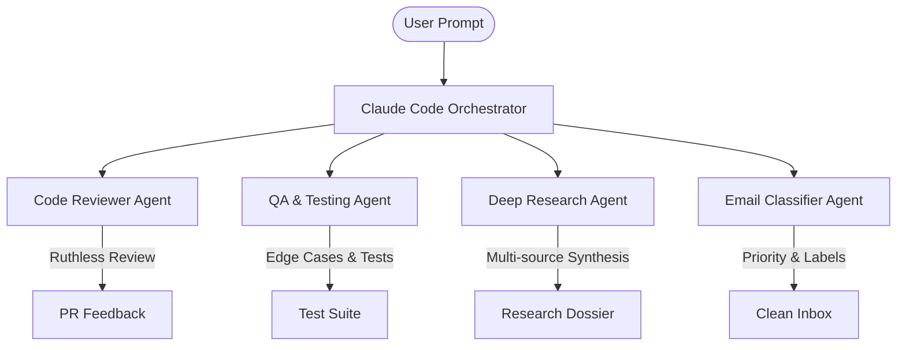

# ⚡ Claude Code Skills Library & Agency Automation Framework

[](https://docs.anthropic.com/en/docs/agents-and-tools/claude-code/overview)
[](https://github.com/Vedant04-tech/claude-code-skills-library)
[](https://github.com/Vedant04-tech/claude-code-skills-library)
[](https://modelcontextprotocol.io)
[](LICENSE)

> **A battle-tested agency automation skills library, autonomous subagents, workflow blueprints, and persistent memory architecture for Claude Code and AI agents.**

This repository serves as a turnkey, production-ready template for AI-assisted development and agency automation. Built for **Claude Code**, **Google Antigravity**, **Cursor**, and **Agentic IDEs**, it packages **53 auto-discovered skills**, 4 high-focus subagents, 3 turnkey pipeline blueprints, 5 Model Context Protocol (MCP) servers, and third-party frameworks.

---

## 📑 Table of Contents

- [✨ Key Highlights](#-key-highlights)
- [📂 Repository Architecture](#-repository-architecture)
- [🚀 Quick Start](#-quick-start)
- [🧠 53 Active Skills Directory](#-53-active-skills-directory)
  - [1. B2B Lead Generation & Enrichment](#1-b2b-lead-generation--enrichment)
  - [2. Cold Outreach & Email Automation](#2-cold-outreach--email-automation)
  - [3. Sales, Proposals & Client Onboarding](#3-sales-proposals--client-onboarding)
  - [4. Video Engineering & Content Outliers](#4-video-engineering--content-outliers)
  - [5. Community Intelligence & Research](#5-community-intelligence--research)
  - [6. Design Engineering, Animation & Craft UI](#6-design-engineering-animation--craft-ui)
  - [7. Vercel, Next.js & Performance Optimization](#7-vercel-nextjs--performance-optimization)
  - [8. Software Craftsmanship & Mobile](#8-software-craftsmanship--mobile)
  - [9. Serverless Infrastructure & Webhooks](#9-serverless-infrastructure--webhooks)
  - [10. Persistent Memory Architecture](#10-persistent-memory-architecture)
- [🤖 Autonomous Subagents](#-autonomous-subagents)
- [📋 Turnkey Workflow Blueprints](#-turnkey-workflow-blueprints)
- [🔌 MCP Servers Suite](#-mcp-servers-suite)
- [💾 Persistent Memory Setup (Optional)](#-persistent-memory-setup-optional)
- [🛡️ Key Principles & Self-Annealing](#-key-principles--self-annealing)
- [🤝 Contributing](#-contributing)
- [📄 License](#-license)

---

## ✨ Key Highlights

- **⚡ Zero-Friction Auto-Discovery**: Drop any folder into `.claude/skills/` or `.agents/skills/`. AI agents discover them on the fly based on intent-driven descriptions.
- **💼 Full-Cycle Agency Stack**: From finding leads on Google Maps and Apify, classifying ICP via LLMs, drafting multi-variant Instantly cold campaigns, to closing with PandaDoc proposals.
- **🎨 Elite Design Engineering Craft Bar**: Infused with Emil Kowalski motion principles, Apple Human Interface Guidelines, View Transitions API, and micro-animation craft.
- **⚡ Vercel & Next.js Performance Engineering**: Pre-loaded with official Vercel engineering best practices, bundle reduction rules, route caching, and token CLI deployments.
- **🧠 Cross-Session Long-Term Memory**: 4 memory skills backed by local SQLite vector storage and Supabase cloud synchronization.
- **👥 4 Ruthless Subagents**: Isolated agents for unbiased code review, test case generation/QA, deep academic research, and high-throughput email classification.
- **🌐 Universal AI Compatibility**: Cross-configured with `CLAUDE.md`, `AGENTS.md`, and `GEMINI.md` to run seamlessly in Claude Code, Cursor, Antigravity, Codex, or custom runners.

---

## 📂 Repository Architecture

```
.
├── .claude/
│   ├── skills/                  # 53 active agent skills (auto-discovered)
│   │   ├── scrape-leads/        # Apify lead scraper + enrichment
│   │   ├── gmaps-leads/         # Google Maps business discovery
│   │   ├── emil-design-eng/     # High craft motion & design engineering
│   │   ├── memory-capture/      # Real-time decision & context capture
│   │   └── ...                  # (53 total skills)
│   ├── agents/                  # 4 specialized subagents
│   │   ├── code-reviewer.md     # Zero-context code review
│   │   ├── qa.md                # Edge-case test generation & execution
│   │   ├── research.md          # Multi-source deep research
│   │   └── email-classifier.md  # High-volume Gmail triage
│   └── settings.json            # Plugin marketplace & MCP server config
├── .agents/                     # Cross-agent compatibility skills mirror
├── agent/                       # Agentic runners compatibility mirror
├── prompts/                     # 3 production workflow blueprints
│   ├── gmaps_lead_pipeline_builder.md
│   ├── upwork_pipeline_builder.md
│   └── instantly_campaign_creator.md
├── docs/                        # Research and roadmap documentation
│   ├── best-claude-code-skills-guide.md
│   └── skill-sources.md
├── vendor/                      # Reference repositories & upstream frameworks
│   ├── superpowers/             # obra/superpowers (TDD, plan execution, debugging)
│   ├── claude-memory/           # Persistent vector memory system (Supabase sync)
│   └── awesome-claude-code/     # Curated community skill references
├── .mcp.json                    # Bundled Model Context Protocol configurations
├── CLAUDE.md                    # Primary workspace rule set for Claude Code
├── AGENTS.md                    # Open agent standards specification
├── GEMINI.md                    # Google Gemini / Antigravity workspace rules
├── package.json                 # Project configuration & dependencies
└── LICENSE                      # MIT Open Source License
```

---

## 🚀 Quick Start

### 1. Clone the Repository
```bash
git clone https://github.com/Vedant04-tech/claude-code-skills-library.git
cd claude-code-skills-library
```

### 2. Launch Claude Code
```bash
claude
```
Claude Code automatically scans and activates all 53 skills in `.claude/skills/`.

### 3. Try Sample Prompts
```bash
# Lead Generation
> "Scrape dental clinics in Austin Texas and qualify them for a website redesign"

# Design Engineering
> "Review my React button animations against Emil Kowalski's motion principles"

# Outreach Campaigns
> "Draft an Instantly 3-step cold email campaign with 2 A/B subject line variants"

# Code Review
> "Delegate this PR to the code-reviewer subagent for a strict, unbiased audit"
```

---

## 🧠 53 Active Skills Directory

### 1. B2B Lead Generation & Enrichment
| Skill | Trigger / Use Case | Description |
|---|---|---|
| [`scrape-leads`](file:///.claude/skills/scrape-leads) | *"Scrape leads for SaaS founders"* | Scrapes and verifies leads using Apify, applies LLM scoring, and pushes to Google Sheets. |
| [`gmaps-leads`](file:///.claude/skills/gmaps-leads) | *"Extract businesses from Google Maps"* | Google Maps scraper with contact discovery (emails, phones, social links). |
| [`classify-leads`](file:///.claude/skills/classify-leads) | *"Score these prospects"* | LLM-based qualification and segment categorizer for CRM sheets. |
| [`casualize-names`](file:///.claude/skills/casualize-names) | *"Clean first names for outreach"* | Normalizes formal names into natural conversational names (e.g., Jonathan → John). |

### 2. Cold Outreach & Email Automation
| Skill | Trigger / Use Case | Description |
|---|---|---|
| [`instantly-campaigns`](file:///.claude/skills/instantly-campaigns) | *"Create a cold email campaign"* | Generates 3-step sequence campaigns in Instantly with multi-angle A/B test variations. |
| [`instantly-autoreply`](file:///.claude/skills/instantly-autoreply) | *"Handle outreach inbox replies"* | Classifies inbound positive/negative responses and crafts context-aware replies. |
| [`welcome-email`](file:///.claude/skills/welcome-email) | *"Send welcome sequence to onboarding client"* | Dispatches automated onboarding sequences for newly closed deals. |
| [`gmail-inbox`](file:///.claude/skills/gmail-inbox) | *"Triage my customer emails"* | Unified inbox manager supporting multiple Gmail accounts and search queries. |
| [`gmail-label`](file:///.claude/skills/gmail-label) | *"Organize emails by priority"* | Automated labeling rules and tag workflows for zero-inbox workflows. |

### 3. Sales, Proposals & Client Onboarding
| Skill | Trigger / Use Case | Description |
|---|---|---|
| [`create-proposal`](file:///.claude/skills/create-proposal) | *"Build a client proposal"* | Generates PandaDoc proposals dynamically using Google Sheets pricing & scope data. |
| [`upwork-apply`](file:///.claude/skills/upwork-apply) | *"Write an Upwork bid for this job"* | Scrapes job posting details and tailors high-converting cover letters & technical bids. |
| [`onboarding-kickoff`](file:///.claude/skills/onboarding-kickoff) | *"Run client kickoff setup"* | Orchestrates project workspaces, document templates, and initial milestone deliverables. |

### 4. Video Engineering & Content Outliers
| Skill | Trigger / Use Case | Description |
|---|---|---|
| [`video-edit`](file:///.claude/skills/video-edit) | *"Cut silence and edit this clip"* | Neural Voice Activity Detection (VAD) to trim dead air and stitch tight jump cuts. |
| [`pan-3d-transition`](file:///.claude/skills/pan-3d-transition) | *"Add a 3D camera swivel between clips"* | Programmatic Remotion 3D pan and camera transition renderer. |
| [`recreate-thumbnails`](file:///.claude/skills/recreate-thumbnails) | *"A/B test thumbnail face swaps"* | AI face-swapping pipeline for YouTube thumbnail iterations. |
| [`youtube-outliers`](file:///.claude/skills/youtube-outliers) | *"Find breakout videos in my niche"* | Detects anomalous high-view videos exceeding average channel view baselines. |
| [`cross-niche-outliers`](file:///.claude/skills/cross-niche-outliers) | *"Find viral concepts in adjacent niches"* | Discovers high-performing content angles across neighboring industries for adaptation. |
| [`title-variants`](file:///.claude/skills/title-variants) | *"Generate 10 YouTube title ideas"* | Crafts high-CTR title variations engineered around curiosity gaps and tension hooks. |

### 5. Community Intelligence & Research
| Skill | Trigger / Use Case | Description |
|---|---|---|
| [`skool-monitor`](file:///.claude/skills/skool-monitor) | *"Monitor Skool community discussions"* | Tracks member posts, unanswered questions, and high-engagement topics. |
| [`skool-rag`](file:///.claude/skills/skool-rag) | *"Search our Skool knowledge base"* | Semantic vector search across historical community threads and masterminds. |
| [`literature-research`](file:///.claude/skills/literature-research) | *"Summarize papers on PubMed/arXiv"* | Queries scientific databases and synthesizes structured academic literature reviews. |

### 6. Design Engineering, Animation & Craft UI
| Skill | Trigger / Use Case | Description |
|---|---|---|
| [`emil-design-eng`](file:///.claude/skills/emil-design-eng) | *"Elevate component craft"* | Enforces Emil Kowalski design engineering principles: springs, physics, and polish. |
| [`apple-design`](file:///.claude/skills/apple-design) | *"Follow Apple Human Interface Guidelines"* | Applies Apple HIG typography, spacing, depth, blur, and fluid interaction patterns. |
| [`web-design-guidelines`](file:///.claude/skills/web-design-guidelines) | *"Audit UI for design system rules"* | Strict checklist audits for accessibility, contrast ratios, and layout stability. |
| [`hallmark`](file:///.claude/skills/hallmark) & [`impeccable`](file:///.claude/skills/impeccable) | *"Add signature polish to this page"* | Visual excellence standards that elevate generic templates to award-winning tiers. |
| [`prototype`](file:///.claude/skills/prototype) | *"Build 3 different versions of this card"* | Generates multiple distinct layout variants behind an interactive switcher component. |
| [`pick-ui-library`](file:///.claude/skills/pick-ui-library) | *"What library should I use for toast alerts?"* | Opinionated recommendation engine for OTPs, virtualization, drag & drop, and charts. |
| [`design-website`](file:///.claude/skills/design-website) | *"Create a landing page in Tailwind"* | Complete responsive web page generation with semantic layout and animations. |
| [`animate`](file:///.claude/skills/animate) | *"Add micro-interactions to this navbar"* | Precision CSS & Tailwind keyframe transitions, spring curves, and hover states. |
| [`animate-expo`](file:///.claude/skills/animate-expo) | *"Animate React Native Expo screen"* | Reanimated and gesture-handler patterns for native mobile performance. |
| [`animation-vocabulary`](file:///.claude/skills/animation-vocabulary) | *"Define easing curves and timing"* | Motion design taxonomy covering durations, dampening, overshoot, and stagger. |
| [`find-animation-opportunities`](file:///.claude/skills/find-animation-opportunities) | *"Where should we add motion?"* | Audits static interfaces to identify delightful interaction moments. |
| [`improve-animations`](file:///.claude/skills/improve-animations) | *"Refine this jarring transition"* | Tunes abrupt linear movements into natural, physics-governed spring animations. |
| [`review-animations`](file:///.claude/skills/review-animations) | *"Audit motion performance"* | Flags layout thrashing, non-composited properties, and jank-inducing CSS. |

### 7. Vercel, Next.js & Performance Optimization
| Skill | Trigger / Use Case | Description |
|---|---|---|
| [`vercel-react-best-practices`](file:///.claude/skills/vercel-react-best-practices) | *"Optimize React component rendering"* | Vercel Engineering rules for Server Components, memoization, and rendering waterfalls. |
| [`vercel-composition-patterns`](file:///.claude/skills/vercel-composition-patterns) | *"Refactor complex component tree"* | Clean compound component architecture and state colocation best practices. |
| [`vercel-optimize`](file:///.claude/skills/vercel-optimize) | *"Reduce Vercel function compute & bills"* | Diagnoses cold starts, data transfer overhead, Edge config, and Core Web Vitals. |
| [`vercel-cli-with-tokens`](file:///.claude/skills/vercel-cli-with-tokens) | *"Deploy to Vercel in headless CI"* | Scripted deployments using auth tokens, environment variable binding, and aliasing. |
| [`deploy-to-vercel`](file:///.claude/skills/deploy-to-vercel) | *"Ship project to Vercel"* | Streamlined zero-configuration production deployment execution. |
| [`vercel-react-view-transitions`](file:///.claude/skills/vercel-react-view-transitions) | *"Implement page transitions in Next.js"* | Native React View Transition API (`<ViewTransition>`) without bulky libraries. |
| [`vercel-react-native-skills`](file:///.claude/skills/vercel-react-native-skills) | *"Review cross-platform React code"* | Shared architectural patterns between web and React Native codebases. |

### 8. Software Craftsmanship & Mobile
| Skill | Trigger / Use Case | Description |
|---|---|---|
| [`write-swift`](file:///.claude/skills/write-swift) | *"Write modern Swift 6 concurrency code"* | Idiomatic Swift 6: data-race safety, actors, task groups, value types, and macros. |
| [`writing-guidelines`](file:///.claude/skills/writing-guidelines) | *"Audit our engineering documentation"* | Audits prose against clarity, punchiness, and Diátaxis documentation principles. |
| [`generate-report`](file:///.claude/skills/generate-report) | *"Export executive analytics PDF"* | Compiles multi-page PDF executive summaries with charts, tables, and KPIs. |

### 9. Serverless Infrastructure & Webhooks
| Skill | Trigger / Use Case | Description |
|---|---|---|
| [`add-webhook`](file:///.claude/skills/add-webhook) | *"Create a serverless webhook on Modal"* | Registers event-driven cloud endpoints for incoming webhooks. |
| [`modal-deploy`](file:///.claude/skills/modal-deploy) | *"Deploy Python function to Modal"* | Ships GPU and serverless Python workloads into Modal cloud infrastructure. |
| [`local-server`](file:///.claude/skills/local-server) | *"Spin up local test orchestrator"* | Runs mock endpoints and orchestration servers for local testing. |

### 10. Persistent Memory Architecture
| Skill | Trigger / Use Case | Description |
|---|---|---|
| [`memory-capture`](file:///.claude/skills/memory-capture) | *"Save key architecture decision"* | Records technical insights and conventions into vector memory during sessions. |
| [`memory-cloud-recall`](file:///.claude/skills/memory-cloud-recall) | *"What did we decide about auth last week?"* | Queries remote Supabase memory when local context window is cleared. |
| [`memory-session-start`](file:///.claude/skills/memory-session-start) | *"Resume context from previous session"* | Ingests recent learnings, active branch goals, and user preferences on startup. |
| [`memory-session-end`](file:///.claude/skills/memory-session-end) | *"Wrap up and summarize session"* | Compiles structured summaries and commits progress checkpoints. |

---

## 🤖 Autonomous Subagents

Located in [`.claude/agents/`](file:///.claude/agents):



1. **`code-reviewer`** ([`code-reviewer.md`](file:///.claude/agents/code-reviewer.md)):
   - **Persona**: Uncompromising senior staff engineer.
   - **Mode**: Zero previous conversational context for complete objectivity.
   - **Focus**: Concurrency bugs, security vulnerabilities, regression risks, and code smell elimination.

2. **`qa`** ([`qa.md`](file:///.claude/agents/qa.md)):
   - **Persona**: Thorough quality assurance lead.
   - **Focus**: Boundary value exploration, failure injection, test generation (Jest/Vitest/Playwright), and automated verification.

3. **`research`** ([`research.md`](file:///.claude/agents/research.md)):
   - **Persona**: Principal technical researcher.
   - **Focus**: Web scraping, API documentation analysis, benchmark synthesis, and technical feasibility reports.

4. **`email-classifier`** ([`email-classifier.md`](file:///.claude/agents/email-classifier.md)):
   - **Persona**: High-throughput communications triage.
   - **Focus**: Separates urgent client requests from cold sales pitches and newsletters in bulk.

---

## 📋 Turnkey Workflow Blueprints

Located in [`prompts/`](file:///prompts):

1. **Google Maps B2B Lead Machine** ([`gmaps_lead_pipeline_builder.md`](file:///prompts/gmaps_lead_pipeline_builder.md))
   - Scrapes local niche businesses from Google Maps.
   - Enriches leads with verified email addresses, owner LinkedIn profiles, and technology stack data.
   - Stores structured outputs in Google Sheets ready for sales outreach.

2. **Upwork Proposal Automation** ([`upwork_pipeline_builder.md`](file:///prompts/upwork_pipeline_builder.md))
   - Parses high-value Upwork job listings filtering for verified payment & budget thresholds.
   - Drafts bespoke, highly relevant technical proposals addressing client pain points.

3. **Instantly Cold Outreach Engine** ([`instantly_campaign_creator.md`](file:///prompts/instantly_campaign_creator.md))
   - Configures 3-tier campaigns with dynamic variables (`{{firstName}}`, `{{companyName}}`).
   - Automatically populates A/B test variations across subject lines and call-to-actions.

---

## 🔌 MCP Servers Suite

Pre-configured in [`.mcp.json`](file:///.mcp.json) and [`.claude/settings.json`](file:///.claude/settings.json):

```json
{
  "mcpServers": {
    "context7": { "command": "npx", "args": ["-y", "@upstash/context7-mcp@latest"] },
    "playwright": { "command": "npx", "args": ["-y", "@playwright/mcp@latest"] },
    "filesystem": { "command": "npx", "args": ["-y", "@modelcontextprotocol/server-filesystem"] },
    "memory": { "command": "npx", "args": ["-y", "@modelcontextprotocol/server-memory"] },
    "fetch": { "command": "npx", "args": ["-y", "mcp-fetch-server"] }
  }
}
```

- **`context7`**: High-performance semantic vector search.
- **`playwright`**: Full browser automation, screenshots, and visual testing.
- **`filesystem`**: Secure, scoped directory manipulation.
- **`memory`**: Local knowledge graph entity and relationship tracking.
- **`fetch`**: High-speed web scraping and markdown conversion.

---

## 💾 Persistent Memory Setup (Optional)

To enable cloud-synced memory across different devices using the bundled [`vendor/claude-memory`](file:///vendor/claude-memory):

1. Navigate to the memory directory:
   ```bash
   cd vendor/claude-memory
   ```
2. Execute the setup script:
   ```bash
   ./install.sh
   ```
3. Set your Supabase credentials in `~/.claude-memory-cloud.env`:
   ```env
   SUPABASE_URL=https://your-project.supabase.co
   SUPABASE_SERVICE_KEY=your-service-role-key
   ```
4. The agent will now persist decisions, code styles, and past tasks indefinitely.

---

## 🛡️ Key Principles & Self-Annealing

1. **Auto-Discovery by Intent**:
   Every skill contains a curated ~100-character description in its `SKILL.md`. Claude Code routes requests to the proper skill autonomously without manual flags.
2. **The Self-Annealing Loop**:
   If an external API changes or a script fails, the agent fixes the implementation and updates `SKILL.md` with the newly learned pattern. The repository gets smarter with every interaction.
3. **Multi-Environment First**:
   All core rules are synced across `CLAUDE.md`, `AGENTS.md`, and `GEMINI.md`, ensuring identical performance regardless of whether your team uses Claude Code, Google Antigravity, or Cursor.

---

## 🤝 Contributing

Contributions are welcome! If you've built a high-leverage skill or workflow:

1. Fork this repository.
2. Create a feature branch: `git checkout -b skill/new-awesome-skill`.
3. Add your skill folder to `.claude/skills/<skill-name>/` containing:
   - `SKILL.md` (with YAML frontmatter: `name` and `description`).
   - Relevant scripts or reference documentation.
4. Test with Claude Code.
5. Open a Pull Request.

---

## 📄 License

This project is licensed under the [MIT License](LICENSE) — free to use, modify, and distribute in commercial and private projects.

---

<p align="center">
  <b>Built with ❤️ by <a href="https://github.com/Vedant04-tech">Vedant04-tech</a></b><br>
  <i>Empowering developers and agencies with autonomous AI workflows.</i>
</p>
